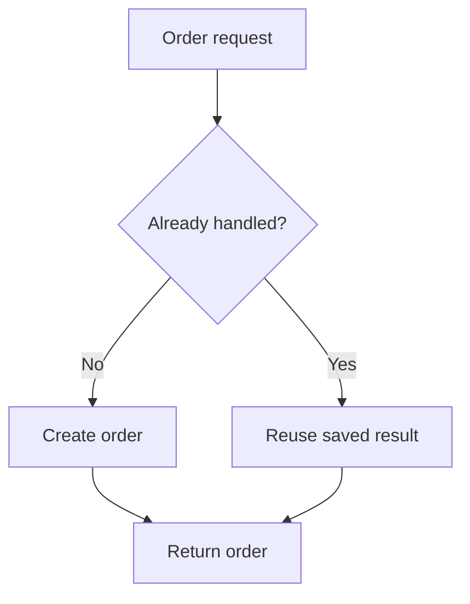

# Explain change without generating an image

Use a tiny state sequence when seeing what changes would help the user distinguish candidates. Translate every visible label into the response language. Adapt the objects to the user's own scenario.

## Contents

- [Pick the smallest useful representation](#pick-the-smallest-useful-representation)
- [Reusable state sequences](#reusable-state-sequences)
- [Complete compact examples](#complete-compact-examples)
- [Plain-text fallback](#plain-text-fallback)
- [Honesty and accessibility](#honesty-and-accessibility)

## Pick the smallest useful representation

1. Use one short prose sequence for a simple action: "Closed → tap → open." This is compact notation, not a pretend animation.
2. Use a Markdown before/action/after table to compare placement, visibility, or timing. It works without an image generator, browser, or executable code.
3. Use two or three numbered frames for a change that needs an intermediate state.
4. Use a small Mermaid diagram only when branching, repeated requests, or topology is the important distinction and the host supports it. Do not turn a one-step action into a large diagram.
5. When a plain-text-only channel cannot render the above and a spatial sketch is necessary, use the ASCII fallback below. Follow the host's formatting capabilities and instructions. Do not select ASCII box art when a supported rendered representation communicates the same thing more clearly.

One illustration for the whole answer is normally enough. For alternatives, a single compact comparison table is preferable to three large illustrations. Avoid code or app generation unless the user separately asks for a working demonstration.

## Reusable state sequences

| Pattern | Before | Trigger or middle state | After | Explain this distinction |
| --- | --- | --- | --- | --- |
| Drawer | Page fills the view | Tap menu; a panel moves inward from an edge | Page plus side panel | Edge placement; say whether it covers or pushes the page only if known. |
| Modal dialog | Page can be used | Open a dialog | Dialog must be handled before the page can be used again | Interaction with the rest of the page is blocked. |
| Popover | Button is visible | Tap button | Small surface opens beside the button | Anchored placement; its content may be interactive. |
| Tooltip | Small icon | Point at it or focus it | Brief explanation appears nearby | Help about a control, not a menu of actions. |
| Accordion | Question only | Tap question | Answer unfolds below it | Expands in the same position. |
| Tabs | "Photos" selected; photos visible | Select "Details" | Same area shows details | Replaces content in one area. |
| Toast | Page unchanged | Save completes | "Saved" briefly appears, then disappears | Short status message; the page remains usable. |
| Skeleton loading | Blank shapes in the content layout | Content arrives | Shapes are replaced by real text and images | Placeholder resembles the coming content. |
| Progress bar | 0% finished | 50% finished | 100% finished | Use numbers only when progress is measurable. |
| Carousel | Photo A is current | Swipe or choose next | Photo B is current | Changes the current item. |
| Sticky header | Header appears in normal page position | Scroll until it reaches the top | Header stays there while its container allows | Sticking begins at a threshold; one still cannot prove it. |
| Fixed header | Header sits at the screen top | Scroll the page | Header remains at the same screen position | The viewport position is held from the start. |
| Scroll reveal | Item is outside view or hidden | Scroll to its region | Item becomes visible, perhaps fading in | Appearance effect; it does not establish when data was fetched. |
| Stagger animation | Three items have not appeared | First appears, then second, then third | All three remain visible | Start times differ across items. |
| Hover effect | Button at rest | Pointer enters | Button changes color or size | Pointer presence rather than activation. |
| Scroll snap | Between two sections | Release the scrolling gesture | View settles on a section boundary | Controls where movement stops. |
| Parallax | Foreground and background aligned | Scroll the same distance | Layers move by different amounts | Different layer speeds suggest depth. |
| Smooth transition | Control in its first state | An intermediate visual state | Control reaches the next state | A gradual change rather than an instant jump. |
| Micro-interaction | Like button at rest | Tap it | A brief reaction confirms the tap | A small response to one action. |
| Optimistic UI | Item not checked | Tap; checkmark appears while saving | Confirm the checkmark, or correct it if saving fails | Visible feedback can precede confirmed completion. |
| Autosave | New writing is unsaved | Pause or saving interval | Writing is saved; status can update | Saving occurs without a manual save action. |
| Idempotent order creation | No order for this request | Same order request arrives twice | One order is reused for that same request identity | Defined repeats do not create extra orders; do not promise every similar request is identical. |
| Background job | Export requested | "Preparing" while the user continues | Download becomes ready | Accepted work and finished work are different states. |
| Scheduled job | Task is waiting | The scheduled time arrives | Work starts | Timing triggers the work; completion may be later. |
| Webhook | Other service is processing | Its event occurs | It tells this app about the event | Another service initiates the notification; delivery may repeat. |
| Polling | Status is unknown | App asks, waits, asks again | App learns the changed status | Repeated checks rather than an assumed push channel. |
| Shared live updates | Two viewers see the old value | One value changes | Other viewers receive an update | Seeing updates does not specify a transport or conflict rules. |
| Authorization | Signed-in person asks to open a record | The server checks permission | Allowed person gets the record; others are denied | An actual access check, not just a hidden button. |
| Cache | Stored reusable result is absent | Read the source and keep a copy | Later eligible requests reuse the copy | Reused data may need refreshing; not an automatic diagnosis of slowness. |
| Autoscaling | Small serving capacity | Demand passes a configured threshold | More capacity is added if available | Capacity changes; it is not just traffic distribution. |
| Failover | One active service is serving | That service fails a relevant check | A prepared replacement takes traffic | A replacement takes over; uninterrupted service is not guaranteed. |
| Backup and restore | Recoverable copy exists | Live data is damaged or lost | Recover to a supported past state | Restore can lose changes newer than the chosen recovery point. |

## Complete compact examples

### A drawer

**Drawer (side panel):** a panel slides out from the edge to show more options.

| Before | After tapping Menu |
| --- | --- |
| Page | Page with a panel entering from the right |

Is a panel that opens from the right what you want?

### A sequence with an intermediate state

**Stagger animation:** items appear one after another, then stay on screen together.

| Frame 1 | Frame 2 | Frame 3 |
| --- | --- | --- |
| Card A | Cards A and B | Cards A, B, and C |

Should the cards appear one at a time like this?

### Invisible processing

**Background job:** the app accepts a big task, works on it, and tells you when it is ready.

| You ask | While it works | When it finishes |
| --- | --- | --- |
| Export the report | Keep using the page | Download the report |

Do you want to keep using the page while the report is prepared?

### Repeated requests with branching

If the user needs the distinction between a new request and the same request again, use this compact diagram only in a Mermaid-capable host. Usually the table above is sufficient.



Label this as a simplified explanation of a configured duplicate-handling boundary. Do not imply a complete payment architecture or a global exactly-once guarantee.

## Plain-text fallback

For an actual plain-text-only channel, use at most three frames, six lines, and roughly 48 characters per line. Keep words in the user's language; do not rely on perfectly aligned wide characters. Explain what the frames mean in prose.

```text
1. [ Page                  ]
2. [ Page            |Menu ]
3. [ Page       | Menu     ]
```

These are successive still frames of a drawer opening, not a live animation. A narrower and often clearer fallback is `Page -> tap Menu -> Page + side panel`.

## Honesty and accessibility

Do not claim that a static table moves, or that an attached screenshot proves animation speed. Do not encode the distinction only in color, arrows, or symbols. Give the behavior in words. A motion preference or need for reduced motion is an implementation detail to preserve when the user states it; it need not become an extra question during every naming exchange.

Pattern meanings and limitations are supported by the primary documentation listed in the domain catalogue files. The frame sequences are original explanatory examples.
